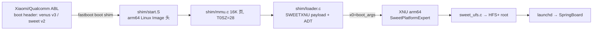

# AI_CONTEXT — ios-sweet → Xiaomi 11 (venus)

> 本文是后续 AI 的项目交接入口。开始任何任务前必须先读本文。
> 事实必须有证据；未知项必须明确标注。详细分析放在 docs/ 下。

## §0 当前状态速览（2026-10-19 晚，最新置顶）

- **Stage-1 通关**：venus shim 真机点屏（用户肉眼确证）。splash_region 活机真值 **0xE2A00000+0x2300000**（静态 dts 0xEA600000 已证伪）；面板 QHD 1440×3200 cmd 模式；boot v3 头；真机 PSCI 通（DTB /psci method 自适应，SYSTEM_OFF 生效）。这正是 shim 的 fb 地址三源统一 + `soc_venus.h` QHD 默认下沉（commits `24cddb4`→`9a16744`）。
- **Stage-4 提前验收第一项**：sweet 的 `ufs.c` 在 venus **零适配只读直通**（UFS 分区清单/EFI PART/GPT 全对，用户实拍）。
- **Stage-2 初步完成**：`tools/mkadt_venus.py`（commit `02593d3`），ADT 带三 RAM bank（0x80000000+0x37500000 / 0xC0000000+0x140000000 / 0x200000000+0x180000000），fbcon reg=0xE2A00000；缺 `d22ap.adt`（Apple IPSW 工件，本地无）→ /product 节点暂缺。
- **Stage-3 进行中——当前卡点**：SWEETXNU payload（16.6MB，mkpayload 未变）作为 v3 ramdisk；ABL 拼接 initrd = vendor cpio(20.13MB)+payload（从 initrd 区间 0xADC6C000-0xAFF7ECD6=0x2312CD6 推断）。**真实堵墙：总手动反复次 magic 全区扫描判"no SWEETXNU"**；且 shim 的 `restart_reason()` 会写 sweet 的 IMEM 地址 0x146AA65C → venus IMEM 基址不同 → data abort（用户实拍蓝屏异常页 ESR 0x96000010 / FAR 0x146AA65C / STAGE loader / X30≈RESTART_BOOTLOADER 0x77665500）。修复中：venus IMEM 基址（查 dtsi）或跳过 IMEM 写直接 PSCI reset。
- **诊断铁律**：venus 没有可用串口，屏幕=唯一输出通道；诊断页一律 HOLD 不自动 reset；用户拍照是最高价值证据。
- **最新 commits**（venus-probe，不 push）：`02593d3` mkadt_venus、`93b2368` notes、`0ba1ea3` initrd 全扫、`4b46496` notes、`7bb9840` hex dump+字节步进+HOLD。生产链在笔记本 `~/ios-sweet-vp4`，payload 固定 `out/payload-venu0.bin`（相对 shim/）。
- **本会话已沉淀关键事实入库**（hindsight 记忆库 initiated 但如不可用则**以本文为本节真值源**）。
- 详细见 docs/RESEARCH_LOG.md 「第四次/第五次/第六七次/v4/第八次」节。

## 1. 项目目标

- **目标设备**：Xiaomi 11 (`venus`)，Snapdragon 888 / SM8350，**bootloader 已解锁**，运行类原生（non-MIUI）ROM。
- **原目标设备**：Redmi Note 10 Pro (`sweet`)，SM7150 / Snapdragon 732G。
- 上游/本地仓库：https://github.com/Duncan588/ios-sweet （即用户自己的 fork）
- 本地（当前）：`E:\Hackios\ios-sweet`（Windows 侧克隆，main，基准 sha 见 §14）
- 最终目标：让 XNU + iOS 16.7.16 (20H392) 用户态在 Xiaomi 11 上启动并尽可能运行。
- **当前阶段**：Stage-0/1 —— 文档与基线搁置；下一优先任务见 §9。
- 最后更新：2026-10-19

## 2. 开始任务前必读顺序

1. `AI_CONTEXT.md`（本文）
2. `docs/XIAOMI_11_PORTING_ROADMAP.md`（路线图 / 当前阶段）
3. `docs/HARDWARE_COMPARISON.md`（硬件事实，判断是否可信）
4. `docs/RESEARCH_LOG.md`（一切调查记录与来源）
5. `docs/DECISIONS.md`（ADR）
6. `docs/VALIDATION_CHECKLIST.md`（每阶段验收）
7. 仓库自身 `README.md` / `NOTES.md`（sweet 原项目知识）

**可信度规则**：[VERIFIED]/[SUPPORTED]/[SUPPORTED]/[UNVERIFIED]/[REJECTED]；推测不得写成事实；结论必须附来源（本地路径/行号 或 URL+commit）。

## 3. 可信度标记

- [VERIFIED]  已由代码、构建、日志或实机证实
- [SUPPORTED] 有可靠一手资料支持，尚未实机验证
- [HYPOTHESIS] 合理推测，仍需实验
- [UNKNOWN]   缺乏足够证据
- [REJECTED]  已被证据否定

## 4. 项目状态摘要

### 已证实（sweet 上游能力，全部来自仓库文件）
- iOS 16.7.16 用户态在 sweet 上**已启动到主屏**：解锁、触摸、按键、CPU 渲染 20–30fps（`README.md:5-8`）。
- 完整启动链可用：fastboot boot v2 shim → XNU (xnu-8796/iOS16) → HFS+ root → launchd（`README.md:63-107`）。
- 内核 81 个补丁序列在 GH Actions macOS runner（Xcode 15 + iig ABI）可重复构建（`.github/workflows/xnu.yml`）。
- 持久日志：内核 kprintf→userdata 尾部 4MiB ring，recovery 可拉（`tools/sweet-log-pull.sh`、patch 0047）。
- 安全均 stub / 关闭：AMFI、Sandbox、KeyStore、Watchdog、Battery fake；不含实际校验（`README.md:28-35`）。
- 上游当前卡点：USB ECM 网络 configd 未把路由应用到 ue0（`NOTES.md:9-17`）。

### 未实现（both sweet and venus）
- Wi-Fi/蓝牙/蜂窝/音频/相机/传感器/GPS/SEP/GPU；离开单个应用；App Store。
- 任何 venus (SM8350) 设备上的验证（0 实验）。

### 未知 / 待验证（关键）
- venus 的 boot 镜像 v3/vendor_boot/AVB 下 shim 能否 `fastboot boot`。
- venus 实机 RAM 可用窗口（carve-out 布局）与 ABL 传参。
- SM8350 UFS 3.1 驱动可行性；1440p@120Hz AMOLED ABL splash 帧缓冲是否可用；Samsung FTS 触控协议。
- RPMh/PM8350 最低 vote 与缺 vote 的复位风险。

## 5. 启动链与架构（证据待扩展进 docs/RESEARCH_LOG.md）

> 图为结构框架（Sweet 路径全部 [VERIFIED]），venus 上 ①boot 格式 ②RAM 窗口 ③ABL 传参均为 [UNKNOWN]；逐节点证据见 `docs/RESEARCH_LOG.md` §2。

## 6. 仓库关键路径索引

| 路径 | 用途 | 状态 |
|---|---|---|
| `README.md` | sweet 移植公开说明（boot args、patch 表） | 已证实 |
| `NOTES.md` | 原工程 handoff 日志（2026-10-15 起） | 已证实 |
| `shim/` | 裸金属引导 shim（C+asm，boot v2 打包） | 已证实 |
| `xnu/patches/` | 81 补丁 + 3 个 stage .sh（CI 唯一顺序真值） | 已证实 |
| `.github/workflows/xnu.yml` | 内核 CI（macos-14，artifact xnu-kernel） | 已证实 |
| `tools/mkadt.py` | ADT 生成，**设备硬编码中心**（移植主要改点） | 已证实 |
| `tools/mkpayload.py` | SWEETXNU payload（kernel+ADT+ramdisk） | 已证实 |
| `tools/mkiosroot.sh` | iOS16 rootfs 制作（Linux+sudo） | 已证实 |
| `docs/`（本次新增） | venus 移植长期文档 | 新建 |

## 7. 设备硬件事实表（详细版见 docs/HARDWARE_COMPARISON.md）

| 项目 | `sweet` | `venus` | 置信 |
|---|---|---|---|
| SoC | SM7150 / 2×A76+6×A55 ARMv8.2 | SM8350 / 1×X1+3×A78+4×A55 **ARMv9** | SUPPORTED |
| boot 格式 | v2 单分区 | **v3 + vendor_boot + AVB**（A/B，boot 分区实测 192MiB 双槽） | SUPPORTED↑（adb+root 自证） |
| RAM 窗口 | 0xb0000000+1.2G / highmem 数据已实测 | LPDDR5，carve-outs 实测 UNKNOWN，**但已有 APatch su 通道可直接 dump FDT/iomem（S2 即可走）** | UNKNOWN→可解 |
| GIC/Timer | GICv3，vtimer INTID 19，19.2MHz | 同型（待实机验证） | SUPPORTED↓ |
| UFS | UFSHCI 2.1 @0x1d84000 | **bootdevice 同址 0x1d84000（adb cmdline 自证）**，UFS 3.1 协议差异待验 | SUPPORTED↑ |
| 显示 | 1080×2400 ABL splash @0x9c000000 | 1440×3200@120Hz AMOLED，地址 UNKNOWN | SUPPORTED |
| 触控 | Goodix GT9896 @I²C 0x5d | Samsung ST FTS（固件协议不同） | SUPPORTED |
| PMIC | PM6150，少 RPMh vote | PM8350 序列，vote 供给更严 | SUPPORTED |

## 8. 构建环境（已确认/待确认）

- XNU 内核：**GitHub Actions macOS runner（macos-14）**，Xcode 15 + iig ABI，MACHINE_CONFIG=SWEET（`xnu.yml:39-75`）。Linux 不能替代。
- shim：Linux 笔记本 `aarch64-linux-gnu-gcc` + `mkbootimg`（`shim/build.sh`）。
- iOS rootfs：Linux + apfs-fuse + hfsprogs + sudo（`tools/mkiosroot.sh`）。
- QEMU 冒烟：`tools/qemu-sweet.py`（`-M virt`），venus 配置版待建。
- 当前 Windows 侧：git 克隆完成；adb 通道 = 经笔记本 ssh 转发（手机连笔记本，Windows 本机 `adb devices` 无设备属正常）。

## 9. 路线图与当前优先级

- 当前阶段：**Stage-0（安全前提）→ Stage-1（venus 首个 fastboot boot 探针）**
- 下一步唯一优先任务：**生成最小 v3 shim 探针并在 venus 上 `fastboot boot` 观察帧缓冲输出**（不刷写任何分区）。
- 完成判据：venus 屏幕出现一行 shim 探针文字，且 `fastboot` 无 brick；失败需能拔电重入 fastboot。
- 依赖与风险：boot v3 打包格式验证、AVB flags、屏幕分辨率未知 → 详见路线图。

## 10. 决策记录摘要（详细见 docs/DECISIONS.md）

| ID | 决策 | 状态 |
|---|---|---|
| ADR-0001 | 仓库提供 fork = `Duncan588/ios-sweet`，本地克隆为准 | Accepted |
| ADR-0002 | 文档一律本地生成、暂不推送到 Linux；后续打包推送 | Accepted |
| ADR-0003 | 禁用一切小米官方工具（MiFlash 等），仅用 adb/fastboot 开源平台工具 | Accepted |
| ADR-0004 | bootloader 已解锁；活动系统为类原生 ROM | Accepted |

## 11. 失败实验与禁止重复的尝试

| 日期 | 实验 | 结果 | 原因 |
|---|---|---|---|
| 2026-10-19 | 笔记本直连 github.com 克隆 | REJECTED | 443 连不上（网络限制），改在 Windows 克隆 |
| 2026-10-19 | Windows adb 找 venus | [REJECTED→已解决] 设备在笔记本不在 Windows；手机确认授权后经 ssh-notebook adb 可用 | 查找路径要按连接拓扑，不能假设 adb 就在本机 |
| 2026-10-19 | ssh+adb getprop 批量采集 | 首次失败：外层双引号把远程 `\$var` 剥离致命令在笔记本本机执行（未触手机） | PowerShell 双引号会展开 `\$`，远程 shell 变量必须转义为 `` `\$var `` |

## 12. 安全与恢复约束

- 未经用户明确批准：不 `fastboot flash`、不 `erase`/`format`、不解锁、不覆盖 userdata。
- `fastboot boot` ≠ 零风险；每次真机测试前须写明镜像、副作用、恢复方案。
- 不将备份、校准数据、密钥、Apple 固件镜像、IMEI 提交进 git。
- 不使用小米官方工具（MiFlash/小米助手等）；只允许 adb/fastboot（Android platform-tools）与开源工具。
- 不自动 push/发布/重写公共历史。

## 13. 外部资料索引（详见 docs/RESEARCH_LOG.md）

| 主题 | 来源 | 版本 |
|---|---|---|
| SM8350 dtsi（一手） | https://android.googlesource.com/kernel/common/+/2fff00c81d4c37a037cf704d2d219fbcb45aea3c/arch/arm64/boot/dts/qcom/sm8350.dtsi | 2fff00c8 |
| venus 机译规格 | https://wiki.lineageos.org/devices/venus/ | 当前 |
| venus boot/vendor_IO 版本 | https://github.com/LineageOS/android_device_xiaomi_sm8350-common/blob/lineage-23.2/BoardConfigCommon.mk | lineage-23.2 |
| venus 内核 DPanel dtsi | https://github.com/Demon000/kernel_xiaomi_sm8350 (commit aac7b59) | aac7b59 |

## 14. 最近交接记录

- 日期：2026-10-19
- 本次目标：首轮审计 + Stage-0/1 推进
- 已完成：仓库克隆（Windows+Linux 双侧，Linux@ e29ba8a + 工具链全齐含 apfs-fuse 源码编译）；docs 6 篇初稿；adb 只读侦查（LAHAINA enhance：活动槽 _b、APatch root 通道、boot 192MiB/vbmeta 128KiB 等）；**CI 基线 run 39193640899 SUCCESS（7m47s），xnu-kernel 已下载本地 xnu/out**
- 执行的设备命令：全部只读 adb/`su -c`；未执行任何 flash/reboot/boot

### 待办（S1 具体缺口）
- unpack_bootv2.py 扩展 v3/v4（当前解 v3 会除零）
- build.sh 的 mkbootimg v3 参数与 dtbo 挂接
- venus dtbo/vendor_boot 只读 dump（root `su -c 'dd ...' → adb pull`）——留给用户批准的会话做
- 尚存风险：见 §7 UNKNOWN 列
- 当前阻塞：venus adb 授权未确认
- 下一步唯一优先任务：见 §9
- 是否涉及设备写入：否（仅只读 adb 探测）
- 文档更新情况：本文件 + 5 篇 docs 新建
